# Activity Diagrams

งาน [#145](https://github.com/GearJP2/cs261-group2-100001/issues/145) · คนหลัก GearJP2 · จัดทำย้อนหลัง 2026-11-14 · baseline `e0edf10`

flow อนุมัติ/ถอนใช้ Party lock ร่วมกัน; US4 ยังเป็น service-only ส่วน No-show ใช้ policy ที่อนุมัติแล้ว แต่ endpoint ปิดโดยค่าเริ่มต้น การอนุมัติไม่ได้เกิดอัตโนมัติเมื่อมีที่ว่าง

Source of truth: `backend/parties/services.py, backend/conduct/services.py, backend/conduct/policy.py`. อ้าง requirement/policy ที่ยืนยันร่วมกับ implementation; สถานะด้านล่างเป็นระดับโค้ด ไม่ใช่ผล UAT

## join-leave

[แก้ไข Mermaid](join-leave.mmd) · [เปิด SVG](join-leave.svg)

## no-show

[แก้ไข Mermaid](no-show.mmd) · [เปิด SVG](no-show.svg)

