# Architecture / Component Diagram

งาน [#144](https://github.com/GearJP2/cs261-group2-100001/issues/144) · คนหลัก GearJP2 · จัดทำย้อนหลัง 2026-11-14 · baseline `e0edf10`

แสดงโครงสร้าง logical components; middleware ทำงานก่อน view และ guard เป็น decorator ของ business API Login มี flow ของตนเอง ไม่ต้องผ่าน verified-user guard ก่อนตรวจ credentials

Source of truth: `backend/config/urls.py, backend/config/settings.py, backend/core/api.py, backend/accounts/decorators.py, backend/*/services.py`. อ้าง requirement/policy ที่ยืนยันร่วมกับ implementation; สถานะด้านล่างเป็นระดับโค้ด ไม่ใช่ผล UAT

## components

[แก้ไข Mermaid](components.mmd) · [เปิด SVG](components.svg)

