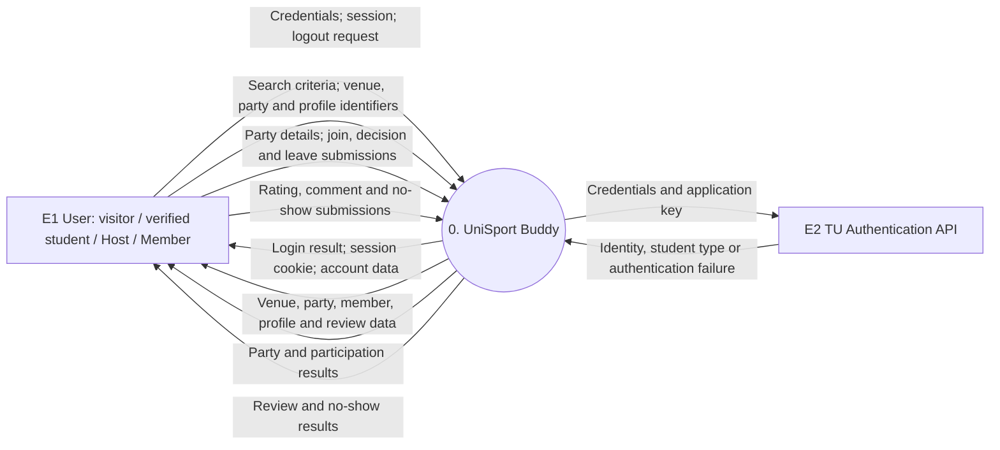
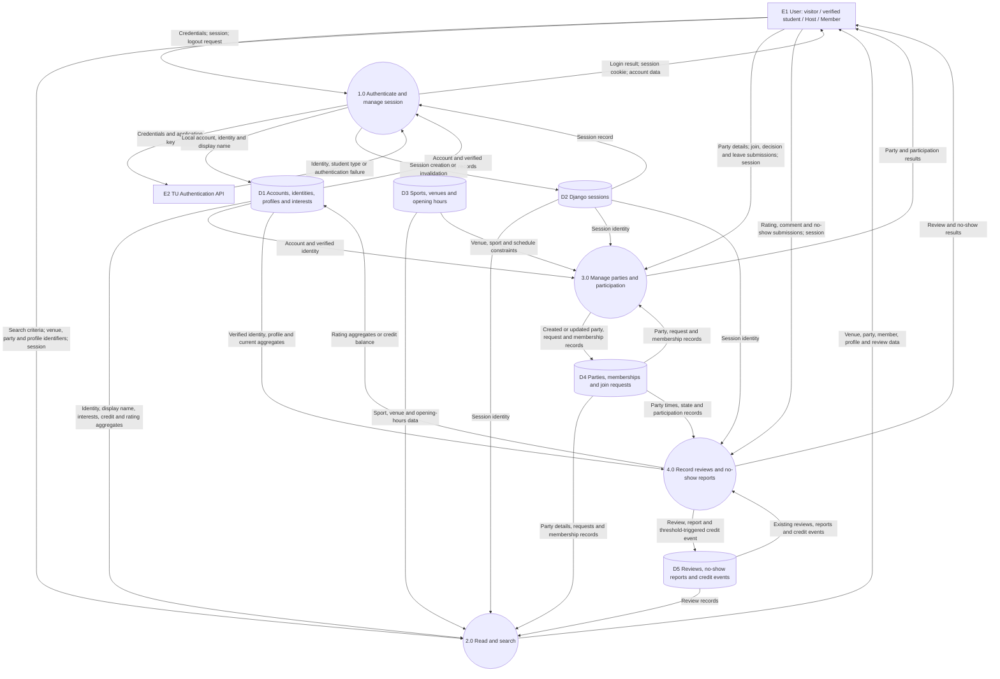

# Data Flow Diagram — UniSport Buddy

จัดทำย้อนหลังจากโค้ด baseline `6eb6d35a90191a80cc5e2c5edd98941a3c4d197f` วันที่ 18 พฤศจิกายน 2026 โดยผู้ช่วยตามคำขอ Gear ครอบคลุมระบบ Sprint 1–2 ไม่ใช่หลักฐานว่าออกแบบก่อนพัฒนาหรือทดสอบระบบใหม่

ใช้ logical DFD: สี่เหลี่ยมคือ external entity, วงกลมคือ process, รูปทรงฐานข้อมูลคือ logical data store และลูกศรคือข้อมูลที่ส่ง ไม่ใช่ลำดับการทำงาน ใช้ Mermaid เพื่อเปิดดูบน GitHub; สัญลักษณ์ store เป็นการประยุกต์ ไม่ใช่สัญลักษณ์ Yourdon/Gane–Sarson แบบเคร่งครัด

## แยกตาม User Story

เลือกเปิดแต่ละ US ได้จากตาราง ภาพรวมด้านล่างใช้ดูความเชื่อมโยงทั้งระบบ; แต่ละหน้ามี Context ของ US และ Level 1 ที่แตกกระบวนการภายใน เลข process เริ่มใหม่ในแต่ละ US โดย D1–D5 ใช้ data dictionary เดียวกัน

| User Story | Data Flow Diagram |
|---|---|
| US1 | [Login / logout](us1/README.md) |
| US2 | [Search parties](us2/README.md) |
| US3 | [Request to join](us3/README.md) |
| US4 | [Leave party](us4/README.md) |
| US6 | [View party members](us6/README.md) |
| US7 | [Manage and view parties](us7/README.md) |
| US8 | [View profile](us8/README.md) |
| US9 | [Browse venues and sports](us9/README.md) |
| US10 | [Approve or reject requests](us10/README.md) |
| US14 | [Reviews and no-show reports](us14/README.md) |

## Context (process 0)

ขอบเขตระบบรวม Browser UI, Django และฐานข้อมูล ผู้ใช้เป็น external entity เดียวโดยมีหลายบทบาท; Host/Member เปลี่ยนตาม Party ส่วน TU API อยู่ภายนอก ข้อมูลผลลัพธ์ทุกกลุ่มรวมข้อผิดพลาดที่เกี่ยวข้องด้วย

[Mermaid source](context.mmd)

## Level 1

แตก process 0 เป็นสี่กระบวนการ ชื่อข้อมูลที่ข้ามขอบเขตยังตรงกับ Context; session ที่แนบกับคำขอใน Level 1 คือข้อมูล session เดียวกับที่ Context รวมไว้ในกลุ่ม authentication ไม่ใช่ external flow ใหม่

[Mermaid source](level-1.mmd)

## Data dictionary และที่มาจากโค้ด

| Store / process | ข้อมูลหรือ implementation |
|---|---|
| D1 | `User`, `UniversityIdentity`, `UserProfile`, `UserSportInterest` ใน [accounts/models.py](../../../backend/accounts/models.py) |
| D2 | `django_session`; ใช้ DB session backend ตาม [settings.py](../../../backend/config/settings.py) |
| D3 | `Sport`, `Venue`, `VenueSport`, `VenueOpeningHour` ใน [venues/models.py](../../../backend/venues/models.py) |
| D4 | `Party`, `PartyMembership`, `JoinRequest` ใน [parties/models.py](../../../backend/parties/models.py) |
| D5 | `PartyReview`, `NoShowReport`, `ConductCreditEvent` ใน [conduct/models.py](../../../backend/conduct/models.py) |
| 1.0 | [accounts/views.py](../../../backend/accounts/views.py), [accounts/services.py](../../../backend/accounts/services.py): login, me, logout; TU credentials ส่งไปตรวจ ไม่เก็บรหัสผ่าน TU ในบัญชี local |
| 2.0 | [parties/views.py](../../../backend/parties/views.py), [venues/views.py](../../../backend/venues/views.py), [accounts/views.py](../../../backend/accounts/views.py), [conduct/services.py](../../../backend/conduct/services.py), [core/views.py](../../../backend/core/views.py): Search, Detail, My Parties, Members, Profile, Reviews |
| 3.0 | [parties/services.py](../../../backend/parties/services.py): create/edit/cancel, join, approve/reject, leave |
| 4.0 | [conduct/services.py](../../../backend/conduct/services.py), [conduct/views.py](../../../backend/conduct/views.py): review, no-show และการอัปเดต aggregate/credit |

D1–D5 เป็นการจัดกลุ่มเชิงตรรกะใน PostgreSQL เดียวกัน ไม่ใช่ห้าฐานข้อมูล การเขียนจากหลาย process ไป D1 หมายถึงคนละ field ไม่ได้เขียนทับ profile ทั้งก้อน

## ข้อกำกับที่ต้องอ่านร่วมกับภาพ

- การอ่านข้อมูลที่เป็น public กับข้อมูลส่วนตัวใช้สิทธิ์ต่างกัน ภาพไม่ได้อนุญาตให้ทุกบทบาทเรียกทุก operation; ดู [authentication guard](../../../backend/accounts/decorators.py) และ guard ใน views/services ประกอบ
- Members จำกัด Host หรือสมาชิก active; Pending/Rejected/ผู้ถอน ไม่ได้สิทธิ์จากการมี JoinRequest เพียงอย่างเดียว
- Create สร้าง Host membership ด้วย; Pending ไม่กินที่นั่ง, Approve จึงเพิ่ม/เปิด membership; Leave บันทึก `left_at` ไม่ลบประวัติ
- `NO_SHOW_ENABLED=false` เป็นค่าเริ่มต้น: ส่วน no-show ใน process 4.0 ใช้งานได้เมื่อเปิด flag เท่านั้น เมื่อปิด route ตอบ 404 และไม่บันทึก report/credit event
- Rating กับ credit เป็นข้อมูลคนละชุด: review อัปเดต `rating_sum`/`rating_count`; no-show หัก credit เมื่อครบ threshold ตาม policy และมี ledger ป้องกันหักซ้ำ ไม่เปลี่ยนดาว
- การอ่าน D1/D2 ใน process 2.0–4.0 รวมการตรวจสิทธิ์ผ่าน middleware/decorator ไม่ได้หมายถึง service ทุกตัว query sessions เอง
- ไม่แสดง Django Admin, seed/import, migration, CI และ transport token ทุกตัวในภาพนี้; scope คือ user-facing application และ TU authentication ส่วน infrastructure ดู [Deployment](../deployment/README.md)

## การเชื่อมโยงและตรวจเอกสาร

Context และ Level 1 ใช้ external entity เดียวกัน ไม่มี entity อ่าน/เขียน store โดยตรง และไม่มี store เชื่อม store โดยไม่ผ่าน process ทั้งสี่ process มี input/output และแต่ละ store มีข้อมูลที่ถูกอ่าน สำหรับ D3 การเติมข้อมูลอ้างอิงอยู่นอก scope นี้

ตรวจชื่อ model, routes, service และค่า flag เทียบกับ baseline แล้ว ภาพใช้ Mermaid source ที่ฝังในหน้านี้ตรงกับไฟล์ `.mmd`; เป็นเอกสารอธิบายข้อมูล ไม่แทนผล browser/API/DB test

อ่านคู่กับ [ERD](../erd/README.md) สำหรับโครงสร้างข้อมูล, [State](../state/README.md) สำหรับสถานะ และ [Sprint 2 Sequence](../../sprint-2-sequences/README.md) สำหรับลำดับเรียกใช้งาน เอกสารเหล่านั้นมี baseline ของตนเอง
