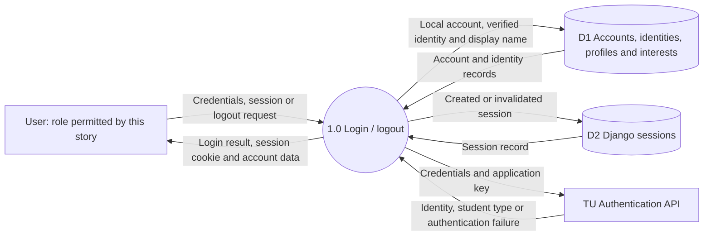

# US1 — Login / logout

[กลับสารบัญ DFD](../README.md) · [Mermaid source](flow.mmd)

มุมมองข้อมูลเฉพาะ US1 จาก baseline `6eb6d35` จัดทำย้อนหลังวันที่ 18 พฤศจิกายน 2026 ใช้ D1–D5 ชุดเดียวกับภาพรวม ไม่ใช่ฐานข้อมูลใหม่หรือแผนภาพลำดับขั้นตอน

รหัสผ่าน TU ส่งไปตรวจที่ TU API ไม่เก็บใน local account; บัญชี local ใช้ unusable password

D1/D2 รวมข้อมูลตรวจสิทธิ์จาก middleware/decorator; ระดับสิทธิ์จริงต่างกันตาม endpoint ไม่ได้หมายถึงทุก flow ต้องยืนยัน TU ใหม่ ไม่มีการอ่าน store โดยตรงจาก browser ข้อผิดพลาดอยู่ในผลลัพธ์กลับผู้ใช้

อ้างอิง [implementation](../../../../backend/accounts/services.py), [routes และสิทธิ์ของบัญชี](../../../../backend/accounts/views.py) และ [data dictionary / ข้อจำกัด](../README.md#data-dictionary-และที่มาจากโค้ด) ภาพนี้เป็นเอกสาร ไม่ใช่หลักฐานว่ารันทดสอบใหม่
