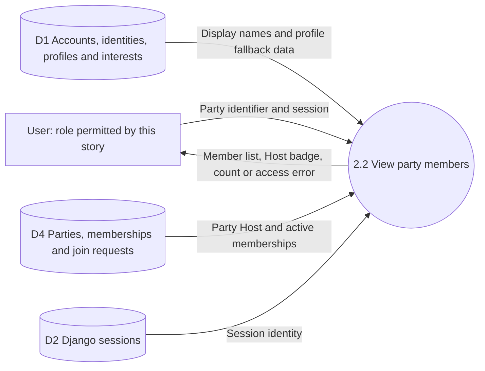

# US6 — View party members

[กลับสารบัญ DFD](../README.md) · [Mermaid source](flow.mmd)

มุมมองข้อมูลเฉพาะ US6 จาก baseline `6eb6d35` จัดทำย้อนหลังวันที่ 18 พฤศจิกายน 2026 ใช้ D1–D5 ชุดเดียวกับภาพรวม ไม่ใช่ฐานข้อมูลใหม่หรือแผนภาพลำดับขั้นตอน

เฉพาะ Host หรือ active Member ดูได้; Pending/Rejected/ผู้ถอน ไม่มีสิทธิ์จาก JoinRequest เพียงอย่างเดียว ไม่เขียนข้อมูล domain

D1/D2 รวมข้อมูลตรวจสิทธิ์จาก middleware/decorator; ระดับสิทธิ์จริงต่างกันตาม endpoint ไม่ได้หมายถึงทุก flow ต้องยืนยัน TU ใหม่ ไม่มีการอ่าน store โดยตรงจาก browser ข้อผิดพลาดอยู่ในผลลัพธ์กลับผู้ใช้

อ้างอิง [implementation](../../../../backend/parties/views.py), [routes และสิทธิ์ของบัญชี](../../../../backend/accounts/views.py) และ [data dictionary / ข้อจำกัด](../README.md#data-dictionary-และที่มาจากโค้ด) ภาพนี้เป็นเอกสาร ไม่ใช่หลักฐานว่ารันทดสอบใหม่
