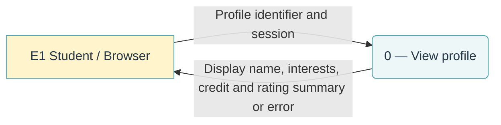
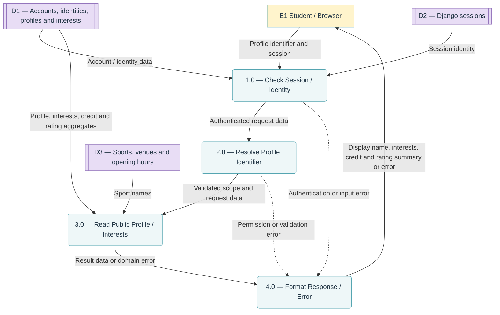

# US8 — View profile

[สารบัญ DFD](../README.md) · baseline `6eb6d35` · จัดทำย้อนหลัง 18 พฤศจิกายน 2026

## Data Flow Diagram Context

[Source](context.mmd)

ผู้ใช้ส่ง Profile identifier and session ระบบส่งกลับ Display name, interests, credit and rating summary or error Process 0 รวมการตรวจสิทธิ์และข้อมูลภายในทั้งหมด จึงไม่แสดง data store ใน Context ไม่มีการเรียก TU API ใหม่ใน US นี้

## Data Flow Diagram Level 1

[Source](level-1.mmd)

### ขอบเขตและข้อกำกับ

ชื่อ public profile หมายถึงข้อมูลที่เปิดให้ผู้ใช้ที่ผ่าน authentication อ่าน ไม่ใช่ endpoint ที่ anonymous อ่านได้; ไม่มีการแก้ไข profile ใน US นี้

ลูกศรแสดงข้อมูล ไม่ใช่การเรียกตามเวลา เส้นประแสดง error data ที่นำไปรวมเป็นผลตอบกลับ กระบวนการย่อย 1.0–4.0 เป็นเลขภายใน US นี้ ส่วน D1–D5 ใช้ความหมายเดียวกับ [data dictionary](../README.md#data-dictionary-และที่มาจากโค้ด) ของระบบ ไม่ใช่ห้าฐานข้อมูล

การอ่าน session และ identity รวมงาน middleware/decorator; กระบวนการอ่านและเขียนในภาพเป็น logical process ไม่ใช่ชื่อฟังก์ชันหนึ่งต่อหนึ่ง ผลสำเร็จและข้อผิดพลาดรวมอยู่ใน response เดียวกันทั้งสองระดับ รูป store ใช้สัญลักษณ์ Mermaid ประยุกต์

อ้างอิง [implementation](../../../../backend/accounts/views.py) และ [authentication](../../../../backend/accounts/views.py) ภาพนี้ไม่แทนผลทดสอบ
