# Deployment Diagram

งาน [#146](https://github.com/GearJP2/cs261-group2-100001/issues/146) · คนหลัก GearJP2 · จัดทำย้อนหลัง 2026-11-14 · baseline `e0edf10`

แสดง dev และ CI ตามไฟล์จริงเท่านั้น runserver ไม่ใช่ production server ยังไม่มี production hosting หรือ reverse proxy ใน repo ค่า port ในภาพเป็น default ที่ override ได้ ไม่ใส่ค่ารหัสผ่านหรือ application key

Source of truth: `docker-compose.yml, backend/Dockerfile, scripts/start-dev.sh, .github/workflows/ci.yml`. อ้าง requirement/policy ที่ยืนยันร่วมกับ implementation; สถานะด้านล่างเป็นระดับโค้ด ไม่ใช่ผล UAT

## dev-ci

[แก้ไข Mermaid](dev-ci.mmd) · [เปิด SVG](dev-ci.svg)

