# ER Diagram

งาน [#142](https://github.com/GearJP2/cs261-group2-100001/issues/142) · คนหลัก GearJP2 · จัดทำย้อนหลัง 2026-11-14 · baseline `e0edf10`

แบ่ง 3 ภาพให้อ่านได้ โดย entity อ้างอิงซ้ำข้ามภาพยังเป็นตารางเดียวกัน ดู schema-reference.md สำหรับ composite unique, CHECK, indexes, nullable และ on_delete ทั้งชุด

Source of truth: `backend/accounts/models.py, backend/venues/models.py, backend/parties/models.py, backend/conduct/models.py และ migrations ของแต่ละ app`. อ้าง requirement/policy ที่ยืนยันร่วมกับ implementation; สถานะด้านล่างเป็นระดับโค้ด ไม่ใช่ผล UAT

## accounts-venues

[แก้ไข Mermaid](accounts-venues.mmd) · [เปิด SVG](accounts-venues.svg)

## conduct

[แก้ไข Mermaid](conduct.mmd) · [เปิด SVG](conduct.svg)

## parties

[แก้ไข Mermaid](parties.mmd) · [เปิด SVG](parties.svg)

[Schema reference และ constraints](schema-reference.md)
