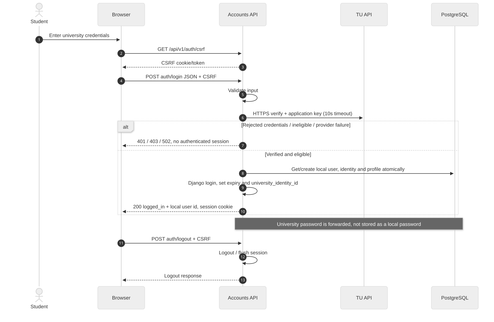
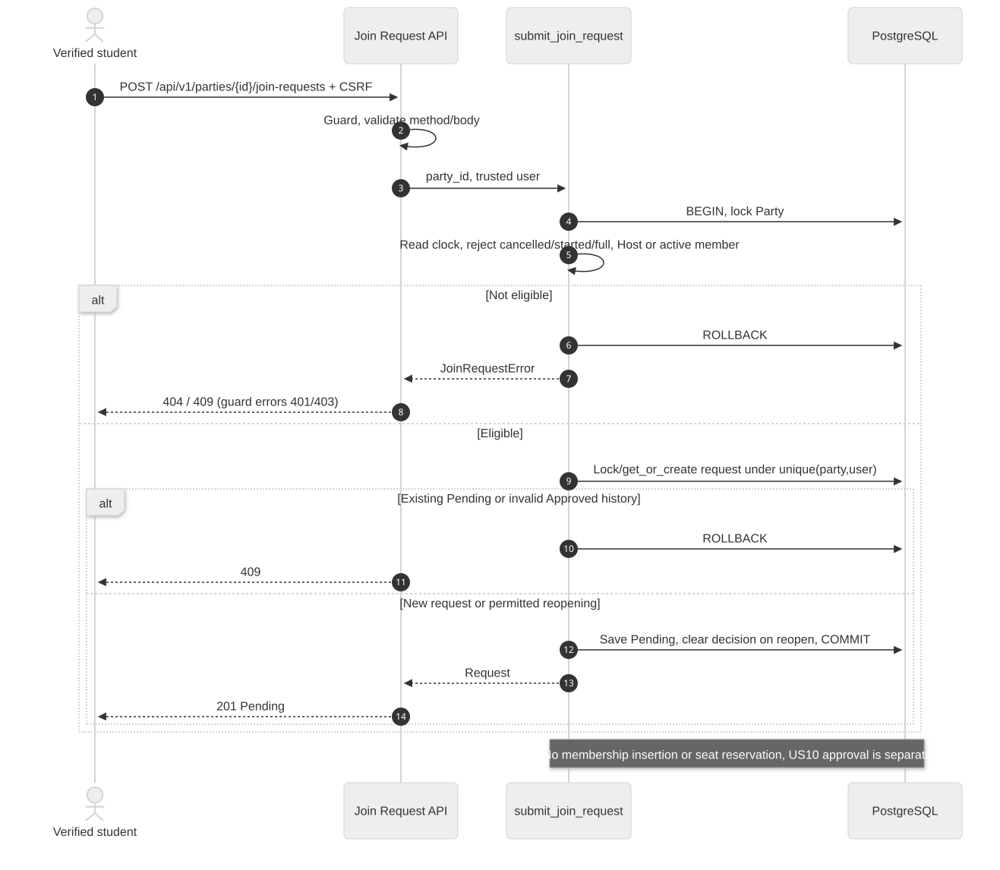
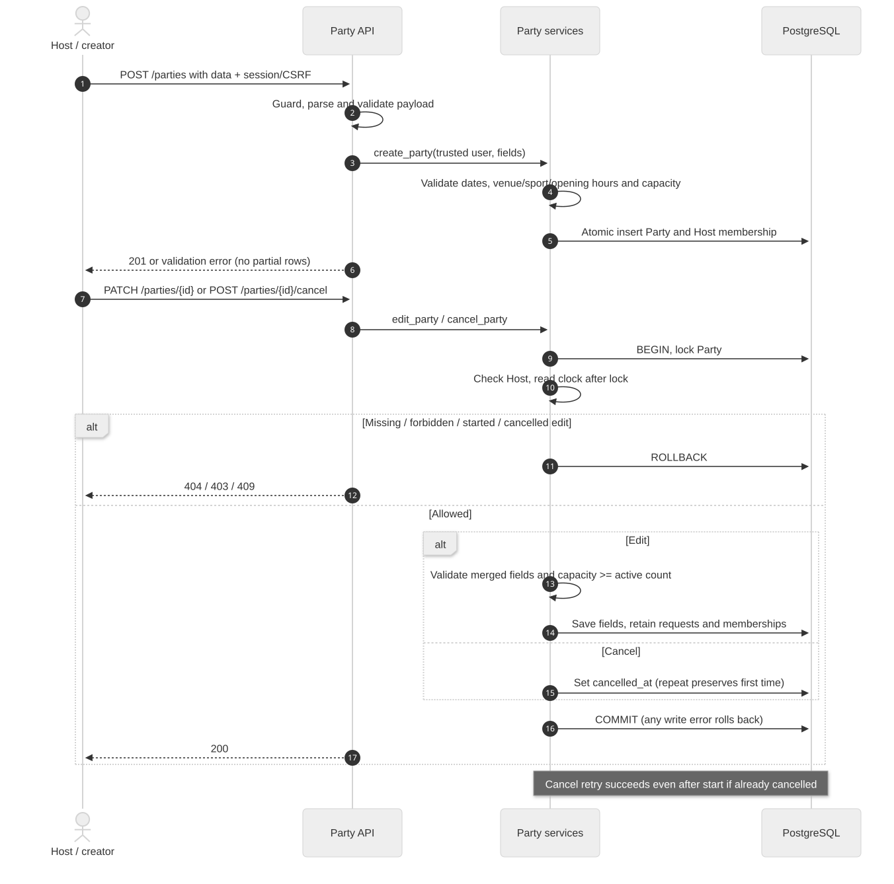
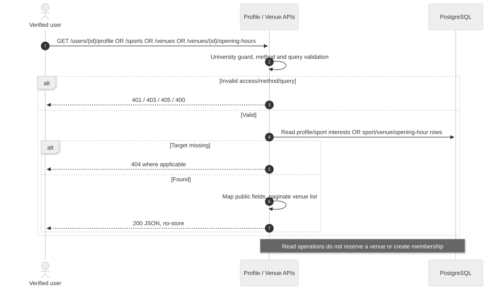

# Sequence audit and Sprint 1 sequences

งาน [#147](https://github.com/GearJP2/cs261-group2-100001/issues/147) · คนหลัก GearJP2 · จัดทำย้อนหลัง 2026-11-14 · baseline `e0edf10`

เพิ่ม sequence ของ Sprint 1 ที่ยังไม่มี source ติดตามใน Git และปรับ source Sprint 2 เดิมใน docs/sprint-2-sequences ไม่แก้ไฟล์ส่วนตัว untracked ใน workspace; ดู audit.md สำหรับข้อแตกต่างและข้อสรุป

Source of truth: `backend/accounts/views.py, backend/parties/views.py, backend/parties/services.py, backend/conduct/services.py`. อ้าง requirement/policy ที่ยืนยันร่วมกับ implementation; สถานะด้านล่างเป็นระดับโค้ด ไม่ใช่ผล UAT

## us1-login

[แก้ไข Mermaid](us1-login.mmd) · [เปิด SVG](us1-login.svg)

## us3-join

[แก้ไข Mermaid](us3-join.mmd) · [เปิด SVG](us3-join.svg)

## us7-manage

[แก้ไข Mermaid](us7-manage.mmd) · [เปิด SVG](us7-manage.svg)

## us8-us9-read

[แก้ไข Mermaid](us8-us9-read.mmd) · [เปิด SVG](us8-us9-read.svg)

[ผล audit](audit.md) · [Sequence Sprint 2](../../sprint-2-sequences/README.md)
