# State Diagrams

งาน [#143](https://github.com/GearJP2/cs261-group2-100001/issues/143) · คนหลัก GearJP2 · จัดทำย้อนหลัง 2026-11-14 · baseline `e0edf10`

แยก Party / JoinRequest / Membership; Party state เป็นค่าคำนวณ ไม่ใช่คอลัมน์เก็บสถานะ การเลื่อนเวลาหรือ capacity ก่อนเริ่มต้องผ่าน validation เดิม ไม่มี transition อัตโนมัติที่เขียนฐานเมื่อเวลาผ่าน

Source of truth: `backend/parties/services.py, backend/parties/models.py`. อ้าง requirement/policy ที่ยืนยันร่วมกับ implementation; สถานะด้านล่างเป็นระดับโค้ด ไม่ใช่ผล UAT

## join-request

[แก้ไข Mermaid](join-request.mmd) · [เปิด SVG](join-request.svg)

## membership

[แก้ไข Mermaid](membership.mmd) · [เปิด SVG](membership.svg)

## party

[แก้ไข Mermaid](party.mmd) · [เปิด SVG](party.svg)

