# Use Case Diagram

งาน [#141](https://github.com/GearJP2/cs261-group2-100001/issues/141) · คนหลัก GearJP2 · จัดทำย้อนหลัง 2026-11-14 · baseline `e0edf10`

ใช้วงรีแทน use case และเส้น association แสดงบทบาท ไม่ใช้ include/extend โดยไม่มีเหตุผล Host สืบทอดความสามารถผู้ใช้ทั่วไปในเชิงบทบาท; ไม่ใช่ strict UML actor glyph. US5/11/12/13 เป็น backlog นอก Sprint 1–2 จึงไม่แสดงเป็นความสามารถที่ทำแล้ว

Source of truth: `docs/user-stories.md, backend/*/urls.py, backend/parties/views.py`. อ้าง requirement/policy ที่ยืนยันร่วมกับ implementation; สถานะด้านล่างเป็นระดับโค้ด ไม่ใช่ผล UAT

## system

[แก้ไข Mermaid](system.mmd) · [เปิด SVG](system.svg)

