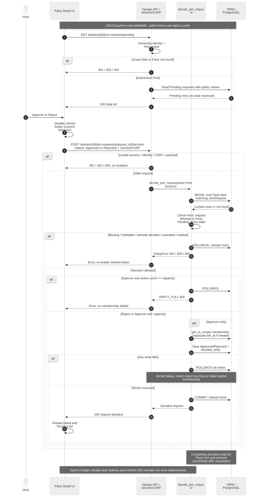
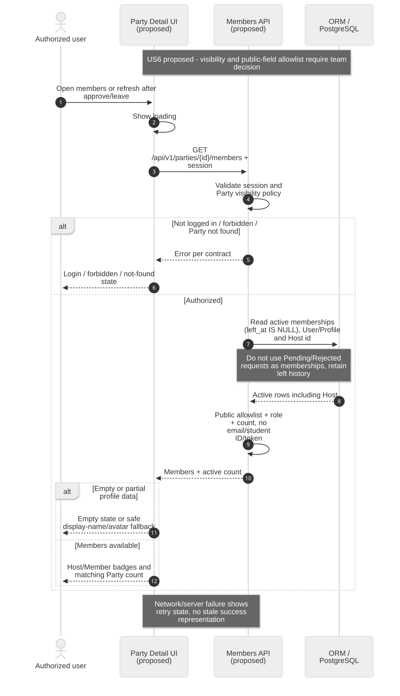
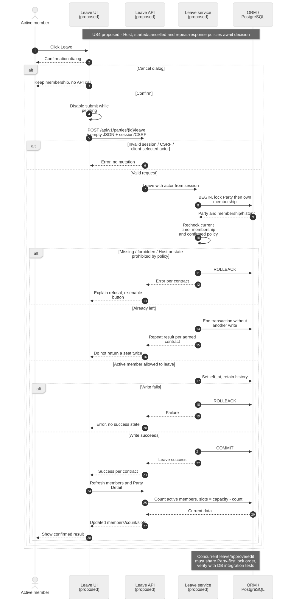
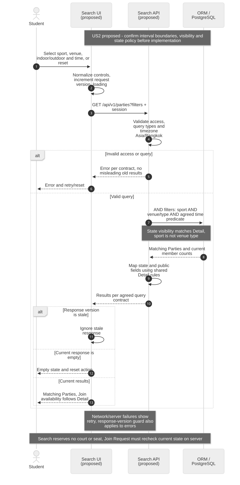
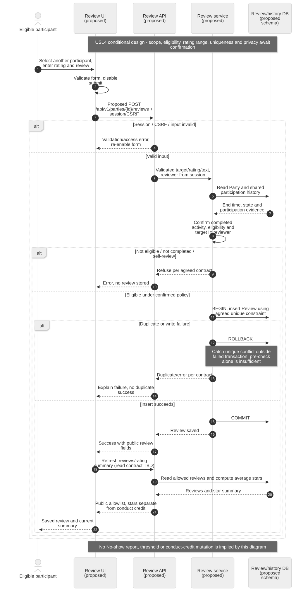

# Sprint 2 — Sequence Diagrams

ตรวจ baseline `main` ที่ commit `b6d4bd0` วันที่ 25 ต.ค. 2026 เอกสารนี้เป็นชิ้นงาน Design ไม่ใช่หลักฐาน UAT หรือการรับรองว่า Sprint 2 พัฒนาเสร็จแล้ว

## สถานะและวิธีอ่าน

| Story | สถานะภาพ | Preview / Mermaid source |
|---|---|---|
| US10 อนุมัติ/ปฏิเสธ | ลำดับตาม implementation ปัจจุบัน พร้อมช่องว่างของเป้าหมาย Sprint 2 | [SVG](us10.svg) / [source](us10.mmd) |
| US6 ดูสมาชิก | Proposed — ยังไม่มี members endpoint | [SVG](us6.svg) / [source](us6.mmd) |
| US4 ถอนตัว | Proposed — ยังไม่มี leave endpoint | [SVG](us4.svg) / [source](us4.mmd) |
| US2 ค้นหา | Proposed — `/parties` ปัจจุบันรับ POST สร้างปาร์ตี้ ยังไม่มี GET search | [SVG](us2.svg) / [source](us2.mmd) |
| US14 รีวิว | Proposed / policy pending — ยังไม่มี Review model หรือ endpoint | [SVG](us14.svg) / [source](us14.mmd) |

ไฟล์ `.mmd` แก้ไขได้และนำเข้า Mermaid/draw.io ได้; SVG เป็น preview ที่เปิดแบบ offline ได้ อ่านจากบนลงล่าง: เส้นทึบคือ request, เส้นประคือ response, `alt` คือทางเลือก, `opt` คือทางเลือกทำเพิ่ม

- API paths ในภาพใช้ prefix `/api/v1` ทั้งหมด UI เป็น browser/template/JavaScript; API เป็น Django view; service เป็น business rules; DB คือ Django ORM/PostgreSQL
- ทุก mutating request ต้องผ่าน session/CSRF ก่อน service; actor มาจาก session ไม่เชื่อ user ID จาก client สำหรับการตัดสินคำขอหรือถอนตัว
- Proposed paths เป็นข้อเสนอจาก `docs/tasks.md` ไม่ใช่ endpoint ที่พร้อมเรียกใช้ ตัวเลข status/error ที่ยังไม่ตกลงเขียนว่า contract แทนการตั้งชื่อใหม่
- Unit Test ตรวจฟังก์ชัน/component โดย mock API/repository/clock; HTTP/SQL/transaction/concurrency เป็น Integration Test ต้องใช้ฐานทดสอบจริงสำหรับพิสูจน์ lock/rollback

## US10 — อนุมัติ / ปฏิเสธ



**Source ที่ตรวจ:** `backend/parties/urls.py`, `views.py: join_requests, decide_join_request_api`, `services.py: decide_join_request` และ `frontend/static/js/app.js: initPartyDetail` (paths เทียบจาก root repository)

**Contract ที่ต้องตกลงก่อนเปลี่ยนโค้ด:** main ใช้ `GET /parties/{id}/join-requests/pending` และ `POST /parties/{id}/join-requests/{request_id}/decision` พร้อม `{status: Approved|Rejected}` แต่ Issue #55 และ Task B-01/B-02/B-03 เสนอ GET รายการที่ `/join-requests` และ POST `/approve` กับ `/reject` แยกกัน ภาพใช้ main เป็น baseline; ห้ามอ้างว่ามี endpoints ที่เสนอแล้ว ต้องตัดสินใจ reuse หรือ migrate พร้อมแก้ callers/tests ในงาน implementation

**ช่องว่าง UI:** main ปิดเฉพาะปุ่มที่กด ไม่ได้ปิดทั้งคู่; สำเร็จ reload หน้าและจำนวนสมาชิก แต่ยังไม่มี active-member list ของ US6 เป้าหมาย Sprint 2 ต้องกันส่งซ้ำและ refresh request/member/remaining slots หลังมี US6 พร้อมกัน

**Concurrency:** ทุกการเปลี่ยนสมาชิก/ความจุที่เกี่ยวข้องต้องใช้ Party lock ลำดับเดียวกันก่อนตรวจจำนวน ที่นั่งสุดท้ายจึงไม่ถูกอนุมัติเกินจำนวน; ยืนยันด้วย IT ไม่ใช่ diagram อย่างเดียว Pending ไม่สร้าง membership/ไม่จองที่นั่ง; Reject ไม่เปลี่ยนสมาชิก ไม่ใช่แบนถาวร การส่งใหม่ใช้ US3 contract ที่ทีมยืนยัน

| AC ใน Story description | ส่วนในภาพ | Checklist ที่ตรวจ |
|---|---|---|
| 1 | lock Party/request, recheck, Approved + membership ใน transaction | UT-US10-API-05; IT-US10-DB-03 |
| 2 | Rejected โดยไม่เขียน membership | UT-US10-API-06; UT-US10-UI-03 |
| 3 | university/Host guard, request belong-to-party, REQUEST_DECIDED | UT-US10-API-01 ถึง 03; IT-US10-DB-02 |
| 4 | cancelled/started/full ก่อน approve | UT-US10-API-04 |
| 5 | serialize ด้วย Party lock และ refresh UI เป้าหมาย | IT-US10-DB-01; UT-US10-UI-01/02 |

## US6 — รายชื่อสมาชิก



Proposed `GET /parties/{id}/members` ใช้ `PartyMembership.left_at IS NULL` รวม Host; Pending/Rejected อยู่ใน JoinRequest ไม่ใช่สมาชิก active คงประวัติคนถอนตัว ใช้ public-field allowlist จาก profile เดิมและกำหนดสิทธิ์ผู้ดูใน S2-US6-D-01 ก่อน implement การ query DB จริงอยู่ใน IT; active predicate/serializer ทดสอบแบบ unit ได้

| AC | ส่วนในภาพ | Checklist |
|---|---|---|
| 1 | active query, role Host/Member และ count | UT-US6-API-04; IT-US6-DB-01 |
| 2 | ไม่ใช้ JoinRequest เป็นรายชื่อสมาชิก | UT-US6-API-03; IT-US6-DB-01 |
| 3 | left_at filter และเก็บประวัติ | IT-US6-DB-03 |
| 4 | allowlist และ fallback | UT-US6-API-02; UT-US6-UI-02 |
| 5 | session/visibility/not-found errors และ UI states | UT-US6-API-01/05; UT-US6-UI-03 |

## US4 — ถอนตัว



Proposed `POST /parties/{id}/leave` กับ body ว่าง ใช้ session actor และ soft leave ไม่ DELETE membership; `remaining_slots = capacity - active_count` ไม่เพิ่ม/ลด counter แยกอีกชุด Policy ของ Host, Party started/cancelled และผลเมื่อเรียกซ้ำต้องยืนยันใน S2-US4-D-01 ก่อน implement ภาพไม่เลือกคำตอบแทนทีม; flow กรณีทั่วไปคือสมาชิก active ถอนก่อนเริ่ม โดย lock Party ก่อน membership ให้เข้ากับ US10

| AC | ส่วนในภาพ | Checklist |
|---|---|---|
| 1 | soft leave + commit + refresh count | UT-US4-API-02; IT-US4-DB-01 |
| 2 | cancel dialog จบใน browser | UT-US4-UI-01 |
| 3 | already-left ไม่มีการเขียนซ้ำ / lock ร่วม approve | UT-US4-API-03; IT-US4-DB-02/03 |
| 4 | actor จาก session / ห้ามถอนแทน | UT-US4-API-01 |
| 5 | policy gate และตรวจเวลาใหม่ภายใต้ lock | UT-US4-API-04/05 |

## US2 — ค้นหา



Proposed `GET /parties` ต้องอยู่ร่วมกับ POST สร้าง Party เดิม ตัวกรอง sport/venue/venue_type แยกกันและรวม AND ค่าเวลาใช้ Asia/Bangkok แต่ต้องยืนยันก่อนว่าเป็น starts-within หรือ overlap และรวมขอบเขตหรือไม่ใน S2-US2-D-01; ไม่ใช้การเลือกในภาพเป็นข้อสรุป Query invalid ต้องไม่คงแสดงผลเก่าราวกับตรงเงื่อนไขใหม่ Pagination/ข้อความค้นหาเพิ่มเฉพาะ contract ที่ทีมยืนยัน ไม่สร้าง scope เพิ่มจากภาพ

| AC | ส่วนในภาพ | Checklist |
|---|---|---|
| 1 | validate + AND query | UT-US2-API-01/02; IT-US2-DB-01 |
| 2 | sport และ venue type คนละ predicate | UT-US2-API-03; UT-US2-UI-01 |
| 3 | normalize timezone และขอบเวลาตามมติ | UT-US2-API-04; IT-US2-DB-02 |
| 4 | loading/empty/error/reset และ response-version guard | UT-US2-UI-02/03/04 |
| 5 | state policy เดียวกับ Detail; join ยังตรวจ server อีกครั้ง | UT-US2-API-05; IT-US2-DB-03 |

## US14 — รีวิวหลังจบ



**รอยืนยัน scope:** การ์ดอยู่ Sprint2 แต่ description ยังระบุ future backlog งาน Design นี้บันทึก flow แบบมีเงื่อนไข ไม่ได้อนุมัติ implementation แทนทีม ต้องยืนยัน eligibility จากประวัติผู้ร่วมกิจกรรม, ช่วงคะแนน, uniqueness, privacy และว่ารวม No-show หรือไม่ใน S2-US14-D-01

Proposed `POST /parties/{id}/reviews` ใช้ reviewer จาก session และ target จากข้อมูลที่ตรวจแล้ว Schema Review ยังไม่มีใน main; uniqueness ที่เสนอคือ party/reviewer/target ต้องยืนยันก่อน migration ภาพแยกดาวเฉลี่ยออกจาก conduct credit และไม่เรียก No-show/หักคะแนน: threshold, จำนวนผู้ยืนยัน และสูตรยังไม่ตกลง เมื่อเกิด unique conflict ต้องจับหลัง transaction rollback แล้วแปลงเป็น error contract; การตรวจ exists ก่อน insert อย่างเดียวกัน concurrent duplicate ไม่ได้

| AC | ส่วนในภาพ | Checklist |
|---|---|---|
| 1 | completed + shared activity history + not self | UT-US14-API-01/02 |
| 2 | duplicate gate + DB unique constraint | UT-US14-API-04; IT-US14-DB-01 |
| 3 | summary ดาวแยกเครดิต | UT-US14-API-05; IT-US14-DB-03 |
| 4 | policy pending / ไม่มี No-show write | UT-US14-API-06 (Blocked จนมีมติ) |
| 5 | input validation, allowlist, UI error/loading | UT-US14-API-03/06; UT-US14-UI-02/03/04 |

## วิธีตรวจและข้อจำกัด

Render ทุก `.mmd` ด้วย Mermaid CLI เป็น SVG และตรวจ XML/ข้อความ/ลิงก์เอกสาร การแก้ source ต้อง render SVG ใหม่ใน PR เดียวกัน ตัวอย่างเมื่อมี `mmdc` ในเครื่อง:

```sh
mmdc -i docs/sprint-2-sequences/us10.mmd -o docs/sprint-2-sequences/us10.svg -b white
```

ไม่เปลี่ยน runtime/schema/API และไม่ใช้เอกสารนี้ปิดประเด็น policy หรือประกาศผล Unit/Integration Test ว่าผ่านแล้ว

## Issue ของชิ้นงาน Design

- US10: [#113](https://github.com/GearJP2/cs261-group2-100001/issues/113) — คนหลัก P, คู่ช่วย Net
- US6: [#114](https://github.com/GearJP2/cs261-group2-100001/issues/114) — คนหลัก Austin, คู่ช่วย V
- US4: [#115](https://github.com/GearJP2/cs261-group2-100001/issues/115) — คนหลัก Golf, คู่ช่วย Net
- US2: [#116](https://github.com/GearJP2/cs261-group2-100001/issues/116) — คนหลัก Golf, คู่ช่วย V
- US14: [#117](https://github.com/GearJP2/cs261-group2-100001/issues/117) — คนหลัก Austin, คู่ช่วย Net
